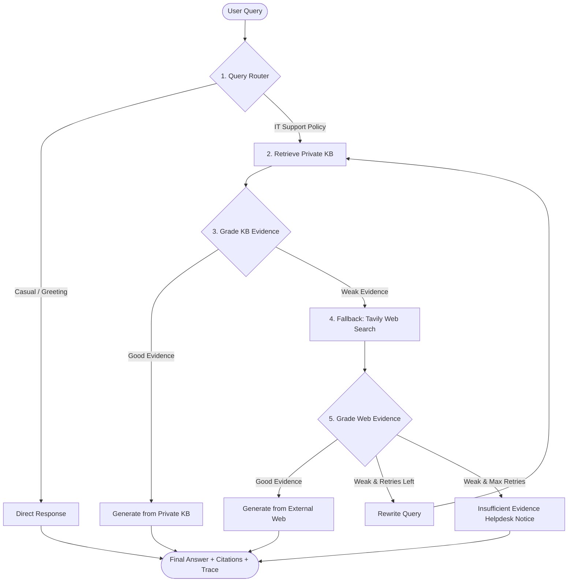

# Enterprise IT Support Agentic RAG Copilot 🚀

An autonomous, production-grade **Agentic Retrieval-Augmented Generation (RAG)** copilot designed for enterprise IT support. Built with **LangGraph**, **FastAPI**, **Qdrant Vector Database**, **Jina Embeddings**, and **Groq LLMs**, this system intelligently routes support queries between private internal runbooks and external vendor search, with self-correction, hallucination grading, and full evaluation metrics.

---

## 🏗️ Architecture & Workflow

The core intelligence is powered by a **LangGraph** state machine implementing self-reflective agentic RAG:



### Key Workflow Highlights
1. **Dynamic Routing**: Dispatches greetings/direct questions directly and routes company-specific IT policy queries to the private knowledge base.
2. **Private Vector Store**: Chunks and indexes company policies (`company_it_handbook.md`, `service_desk_runbook.md`) in **Qdrant Cloud** with 768-dimensional **Jina Embeddings**.
3. **Evidence Grading**: Uses LLM-as-a-judge nodes to ensure retrieved context is relevant and sufficient before answering.
4. **Fallback & Query Rewriting**: If internal runbooks do not cover the question, it searches vendor documentation via **Tavily**, reformulating technical keywords if necessary.
5. **Auditing**: Automatically logs every question, route, timestamp, and step trace to an SQLite audit database.

---

## 📊 Evaluation & Metrics (100% Accuracy)

The system was evaluated against 10 ground-truth enterprise IT scenarios across 5 core RAG metrics synced with **LangSmith**:

$$\text{Accuracy} = \frac{\text{Correct Answers}}{10} \times 100 = \mathbf{100\%}$$

| Metric | Score | Definition |
|:---|:---:|:---|
| **Faithfulness** | **100%** | Answer strictly grounded in retrieved context without hallucination. |
| **Answer Relevancy** | **100%** | Directly addresses and solves the user's inquiry. |
| **Context Precision** | **100%** | Retrieved chunks from Qdrant are accurate and focused. |
| **Context Recall** | **100%** | Retrieved context covers all necessary facts for ground truth. |
| **Answer Correctness** | **100%** | Matches expected reference outputs and policies. |

---

## 📁 Project Structure

```plaintext
Enterprise-IT-Support-Agentic-RAG-Copilot/
├── app/
│   ├── api/
│   │   └── routes.py             # FastAPI REST endpoints (/api/chat, /api/ingest, /api/health)
│   ├── core/
│   │   ├── config.py             # Pydantic Settings & environment loader
│   │   └── logging.py            # Structured logging configuration
│   ├── rag/
│   │   ├── state.py              # LangGraph AgentState TypedDict and models
│   │   ├── vectorstore.py        # Qdrant client, chunking, and retriever
│   │   └── workflow.py           # LangGraph StateGraph pipeline
│   ├── services/
│   │   ├── audit.py              # SQLite audit logging
│   │   ├── embeddings.py         # JinaEmbeddings provider
│   │   └── ingestion.py          # Multi-format document loader (PDF, DOCX, TXT, MD)
│   └── main.py                   # FastAPI app initialization, static mount, and templates
├── data/
│   ├── sample_kb/                # Markdown runbooks and IT policies
│   ├── it_support_10_test_cases.json # 10 IT benchmark test cases
│   └── evaluation_report_10_tc.json  # Full evaluation execution results
├── static/                       # Frontend CSS and Vanilla JS
├── templates/                    # Jinja2 HTML UI (index.html)
├── Dockerfile                    # Containerization definition
├── ingest_sample_kb.py           # Ingestion script to push vectors to Qdrant
├── run_10_tc_eval.py             # 5-metric test case evaluation runner
├── run_evaluation.py             # LangSmith automated evaluation script
├── run.py                        # Uvicorn server entrypoint
└── requirements.txt              # Project dependencies
```

---

## 🚀 Getting Started

### 1. Prerequisites
- Python 3.10+
- Free API keys from:
  - [Groq](https://console.groq.com)
  - [Qdrant Cloud](https://cloud.qdrant.io)
  - [Jina AI](https://jina.ai)
  - [Tavily](https://tavily.com)
  - [LangSmith](https://smith.langchain.com) *(optional, for experiment tracking)*

### 2. Installation
```bash
# Clone the repository
git clone https://github.com/sahilpate3345/Enterprise-IT-Support-Agentic-RAG-Copilot.git
cd Enterprise-IT-Support-Agentic-RAG-Copilot

# Create virtual environment
python -m venv venv
# Windows:
.\venv\Scripts\activate
# Linux/macOS:
source venv/bin/activate

# Install dependencies
pip install -r requirements.txt
```

### 3. Environment Variables (`.env`)
Create a `.env` file in the root directory:
```env
# Application
APP_NAME="Enterprise IT Support Agentic RAG Copilot"
APP_ENV=development
ADMIN_API_KEY=your_admin_secret_key

# Models & LLMs
GROQ_API_KEY=gsk_...
GROQ_MODEL=openai/gpt-oss-120b

# Embeddings & Vector DB
JINA_API_KEY=jina_...
MODEL_NAME=jina-embeddings-v2-base-en
QDRANT_API_KEY=...
QDRANT_URL=https://<your-cluster-id>.sa-east-1-0.aws.cloud.qdrant.io:6333
QDRANT_COLLECTION_NAME=IT_SUPPORT

# Web Search Fallback
TAVILY_API_KEY=tvly-...

# LangSmith Observability
LANGSMITH_API_KEY=lsv2_pt_...
LANGSMITH_ENDPOINT=https://api.smith.langchain.com
```

### 4. Index Knowledge Base
Ingest the sample IT handbook and runbook into your Qdrant cluster:
```bash
python ingest_sample_kb.py
```

### 5. Run the Application
```bash
python run.py
```
- **Web Interface**: [http://127.0.0.1:8000/](http://127.0.0.1:8000/)
- **Interactive Swagger Docs**: [http://127.0.0.1:8000/docs](http://127.0.0.1:8000/docs)
- **Health Check**: [http://127.0.0.1:8000/api/health](http://127.0.0.1:8000/api/health)

---

## 🧪 Running Evaluations

Run the automated 5-metric test case evaluation:
```bash
python run_10_tc_eval.py
```
Or run the LangSmith cloud experiment:
```bash
python run_evaluation.py
```

---

## 🐳 Docker Deployment

Build and run using Docker:
```bash
# Build Docker image
docker build -t it-support-rag-copilot .

# Run container
docker run -p 8000:8000 --env-file .env it-support-rag-copilot
```

---

## 🛡️ License
Distributed under the MIT License. See `LICENSE` for more information.
