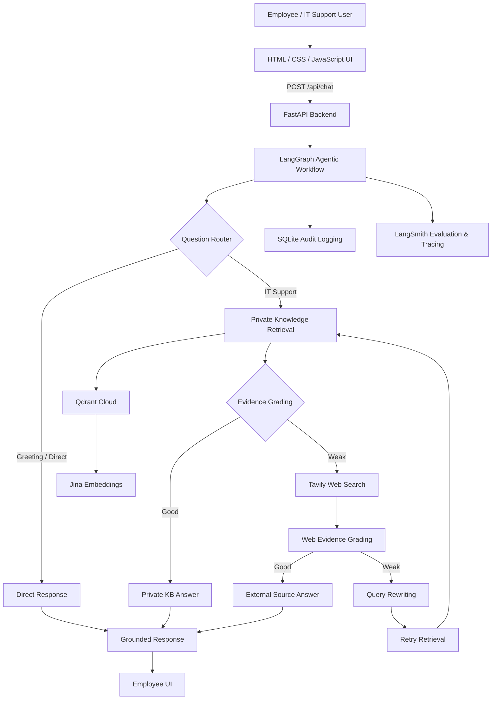

# Enterprise IT Support Agentic RAG Copilot 🚀

[](https://enterprise-it-support-agentic-rag-copilot-ae36.onrender.com/)
[](https://github.com/sahilpate3345/Enterprise-IT-Support-Agentic-RAG-Copilot)

An end-to-end **Forward Deployed Engineering (FDE) project** that transforms enterprise IT support documentation into an intelligent, evidence-grounded support assistant.

- 🌐 **Live Web Application**: [https://enterprise-it-support-agentic-rag-copilot-ae36.onrender.com/](https://enterprise-it-support-agentic-rag-copilot-ae36.onrender.com/)
- 📖 **Interactive Swagger Docs**: [https://enterprise-it-support-agentic-rag-copilot-ae36.onrender.com/docs](https://enterprise-it-support-agentic-rag-copilot-ae36.onrender.com/docs)
- 🩺 **Health Check API**: [https://enterprise-it-support-agentic-rag-copilot-ae36.onrender.com/api/health](https://enterprise-it-support-agentic-rag-copilot-ae36.onrender.com/api/health)

Built using **LangGraph, FastAPI, Qdrant Cloud, Jina Embeddings, Groq LLMs, and Tavily**, this system intelligently routes employee questions between private company knowledge bases and external vendor documentation.

It includes agentic routing, evidence grading, query rewriting, fallback search, document ingestion, audit logging, and RAG evaluation.

---

## 1. Business Problem

### Customer: NovaRetail

NovaRetail is a fictional retail enterprise with approximately 3,000 employees.

Its internal IT department maintains documentation covering:

- VPN configuration and remote access.
- Password management and MFA policies.
- Software installation guidelines.
- Laptop troubleshooting.
- IT security policies.
- Service desk procedures.

Employees frequently raise repetitive IT support tickets because:

- They cannot easily locate the correct internal documentation.
- Traditional keyword search returns irrelevant results.
- Generic chatbots may generate unsupported answers.
- Internal documentation may not cover every technical issue.
- Some questions require up-to-date external vendor information.

### Business Objective

Build an enterprise IT Support Copilot that:

1. Prioritizes trusted internal company documentation.
2. Evaluates retrieved evidence before generating answers.
3. Uses external vendor search only when internal evidence is insufficient.
4. Rewrites weak queries and retries retrieval.
5. Generates answers grounded in available evidence.
6. Exposes the decision path for transparency and debugging.
7. Allows authorized administrators to upload new company documents.
8. Maintains audit logs and evaluation traces.

---

## 2. Why This Is a Forward Deployed Engineering Project

A Forward Deployed Engineer does more than build an AI model or a chatbot.

The objective is to understand a customer's operational problem and turn it into a usable technical solution.

This project demonstrates the following engineering lifecycle:

Customer Problem  
↓  
Discovery & Requirements  
↓  
Solution Architecture  
↓  
Knowledge Base Integration  
↓  
Agentic RAG Development  
↓  
Backend API Development  
↓  
Employee-facing Interface  
↓  
Security, Audit & Evaluation  
↓  
Docker Deployment  
↓  
Monitoring & Continuous Improvement

The solution connects AI engineering with practical enterprise requirements.

---

## 3. System Architecture



### Architecture Principles

- **Private-first retrieval:** Internal company documentation is the preferred information source.
- **Evidence-based decisions:** Retrieved documents are evaluated before answer generation.
- **Controlled external search:** Tavily is used when internal knowledge is insufficient.
- **Self-correction:** Query rewriting helps recover from weak retrieval.
- **Transparency:** Decision traces help developers understand the workflow.
- **Extensibility:** New documents can be added without manually modifying the knowledge base.

---

## 4. Agentic RAG Workflow

The system uses LangGraph to coordinate multiple decision-making stages.

```text
                  Employee Question
                         |
                         v
                  Question Router
                         |
              +----------+----------+
              |                     |
              v                     v
          Direct Chat          IT Support
              |                     |
              v                     v
        Direct Answer         Qdrant Retrieval
                                    |
                                    v
                             Evidence Grading
                                    |
                         +----------+----------+
                         |                     |
                        GOOD                  WEAK
                         |                     |
                         v                     v
                   Private+ KB             Tavily Search
                    Answer                    |
                                              v
                                      Web Evidence Grading
                                              |
                                   +----------+----------+
                                   |                     |
                                  GOOD                  WEAK
                                   |                     |
                                   v                     v
                              Web Answer           Query Rewrite
                                                         |
                                                         v
                                                   Retry Retrieval
                                                         |
                                                         v
                                                   Retry Guard
                                                         |
                                                         v
                                                Insufficient Evidence
```

### Workflow Components

**1. Question Routing**

Identifies greetings, direct conversational questions, and IT support queries.

**2. Private Knowledge Retrieval**

Retrieves relevant company policies and service desk runbooks from Qdrant Cloud.

**3. Evidence Grading**

Evaluates whether retrieved documents contain relevant information to answer the question.

**4. External Search Fallback**

Uses Tavily to retrieve external vendor documentation when internal evidence is insufficient.

**5. Query Rewriting**

Reformulates weak or ambiguous questions to improve retrieval.

**6. Retry Management**

Controls repeated retrieval attempts to avoid unnecessary loops.

**7. Grounded Answer Generation**

Uses the available evidence to generate an answer. If sufficient evidence is unavailable, the system should communicate that limitation rather than inventing a solution.

---

## 5. Technology Stack

| Layer | Technology | Purpose |
|---|---|---|
| Agent orchestration | LangGraph | Stateful workflow and conditional routing |
| LLM | Groq | Routing, grading, rewriting and generation |
| Embeddings | Jina Embeddings v2 | Semantic document embeddings |
| Vector database | Qdrant Cloud | Private enterprise knowledge storage |
| External search | Tavily | Vendor documentation retrieval |
| Backend | FastAPI | REST API development |
| Frontend | HTML, CSS, JavaScript | Employee-facing interface |
| Audit logging | SQLite | Query and decision-path logging |
| Evaluation | LangSmith | Tracing and experiment evaluation |
| Document processing | LangChain | Document loading and chunking |
| Deployment | Docker | Containerized application |

**Note:** The embedding model and vector database remain consistent with the implementation. The Groq model can be configured independently using environment variables.

---

## 6. Project Structure

```text
Enterprise-IT-Support-Agentic-RAG-Copilot/
│
├── app/
│   ├── api/
│   │   └── routes.py
│   │
│   ├── core/
│   │   ├── config.py
│   │   └── logging.py
│   │
│   ├── rag/
│   │   ├── state.py
│   │   ├── vectorstore.py
│   │   └── workflow.py
│   │
│   ├── services/
│   │   ├── audit.py
│   │   ├── embeddings.py
│   │   └── ingestion.py
│   │
│   └── main.py
│
├── data/
│   ├── sample_kb/
│   │   ├── company_it_handbook.md
│   │   └── service_desk_runbook.md
│   │
│   ├── it_support_10_test_cases.json
│   └── evaluation_report_10_tc.json
│
├── static/
│   ├── css/
│   └── js/
│
├── templates/
│   └── index.html
│
├── Dockerfile
├── ingest_sample_kb.py
├── run_10_tc_eval.py
├── run_evaluation.py
├── run.py
├── requirements.txt
├── .env.example
└── README.md
```

---

## 7. Installation and Setup

### Prerequisites

- Python 3.10+
- Groq API key
- Qdrant Cloud account
- Jina AI API key
- Tavily API key
- LangSmith account (optional)

### Step 1: Clone Repository

```bash
git clone https://github.com/sahilpate3345/Enterprise-IT-Support-Agentic-RAG-Copilot.git

cd Enterprise-IT-Support-Agentic-RAG-Copilot
```

### Step 2: Create Virtual Environment

```bash
python -m venv venv
```

Windows:

```powershell
venv\Scripts\activate
```

Linux/macOS:

```bash
source venv/bin/activate
```

### Step 3: Install Dependencies

```bash
pip install -r requirements.txt
```

### Step 4: Configure Environment Variables

Create a `.env` file in the project root.

```env
# Application
APP_NAME="Enterprise IT Support Agentic RAG Copilot"
APP_ENV=development

# Security
ADMIN_API_KEY=your_admin_secret_key

# Groq LLM
GROQ_API_KEY=your_groq_api_key
GROQ_MODEL=openai/gpt-oss-120b

# Jina Embeddings
JINA_API_KEY=your_jina_api_key
MODEL_NAME=jina-embeddings-v2-base-en

# Qdrant Cloud
QDRANT_URL=your_qdrant_cluster_url
QDRANT_API_KEY=your_qdrant_api_key
QDRANT_COLLECTION_NAME=IT_SUPPORT

# Tavily Search
TAVILY_API_KEY=your_tavily_api_key

# LangSmith (Optional)
LANGSMITH_API_KEY=your_langsmith_api_key
LANGSMITH_ENDPOINT=https://api.smith.langchain.com
```

**Groq model configuration:** `GROQ_MODEL` is configurable. Replace the example model with another model supported by your Groq account, provided it is compatible with your implementation.

The embedding model and Qdrant configuration should remain consistent between document ingestion and retrieval.

### Step 5: Ingest Sample Knowledge Base

```bash
python ingest_sample_kb.py
```

Document ingestion pipeline:

```text
Company IT Documents
        |
        v
Document Loading
        |
        v
Text Chunking
        |
        v
Jina Embeddings
        |
        v
768-Dimensional Vectors
        |
        v
Qdrant Cloud
```

### Step 6: Run Application

```bash
python run.py
```

Open the application:

- Web Interface: http://127.0.0.1:8000/
- FastAPI Swagger: http://127.0.0.1:8000/docs
- Health Check: http://127.0.0.1:8000/api/health

---

## 8. Practical Demonstration Scenarios

### Scenario A: Private Knowledge Base Retrieval

**Question:**

How do I connect to the company VPN from home?

Expected workflow:

```text
Question Router
      |
      v
Private KB Retrieval
      |
      v
Evidence Grade: GOOD
      |
      v
Generate Internal KB Answer
```

Expected behavior: The system answers using internal VPN documentation without unnecessarily searching the public internet.

### Scenario B: Internal Security Policy

**Question:**

Can IT support ask me to share my MFA code?

Expected behavior:

The assistant retrieves the internal security policy and explains that employees must never share their passwords or MFA codes.

### Scenario C: External Vendor Information

**Question:**

What is the latest Microsoft Teams outage guidance?

Expected workflow:

```text
Private KB Retrieval
      |
      v
Evidence Grade: WEAK
      |
      v
Tavily Search
      |
      v
Web Evidence Grade
      |
      v
Generate External-Sourced Answer
```

Expected behavior: The system uses relevant external vendor information and distinguishes it from internal company policy.

### Scenario D: Query Rewriting

**Question:**

My work communication app is acting strange after the new update. What should I do?

Expected behavior:

The system attempts to improve the query when retrieval is weak, then retries within its configured limits.

### Scenario E: Direct Conversation

**Question:**

Hello!

Expected workflow:

```text
Question Router
      |
      v
Direct Response
```

Expected behavior: No unnecessary vector database or web search operation.

---

## 9. Document Upload and Knowledge Base Management

The application supports adding company documents through its ingestion functionality.

Supported formats:

- PDF
- DOCX
- TXT
- Markdown

### Ingestion Workflow

```text
Administrator Upload
        |
        v
File Validation
        |
        v
Document Loading
        |
        v
Recursive Text Chunking
        |
        v
Jina Embeddings
        |
        v
Qdrant Cloud Indexing
        |
        v
Available for Retrieval
```

The ingestion endpoint is protected using an administrator API key.

This allows authorized staff to extend the internal knowledge base without manually modifying the application source code.

---

## 10. API Endpoints

| Method | Endpoint | Description |
|---|---|---|
| GET | `/api/health` | Application health check |
| POST | `/api/chat` | Submit an IT support question |
| POST | `/api/ingest` | Upload and index company documents |

### Chat Request

```json
{
  "question": "How do I reset my company password?"
}
```

### Response Structure

The chat API provides an answer along with source information and workflow traces.

```json
{
  "answer": "Answer based on retrieved evidence.",
  "source_used": "private_kb",
  "trace": [
    "Router -> KB",
    "Private KB retrieval",
    "Evidence grade -> GOOD",
    "Answer generation -> PRIVATE KB"
  ],
  "citations": []
}
```

The example illustrates the response structure; actual response fields depend on the API implementation.

### Document Ingestion

```text
POST /api/ingest
```

Protected using:

```text
X-Admin-Key: your_admin_secret_key
```

---

## 11. Evaluation and Observability

The project includes a benchmark of 10 predefined enterprise IT support scenarios.

Five evaluation dimensions are tracked:

| Metric | Purpose |
|---|---|
| Faithfulness | Checks whether answers are supported by retrieved context |
| Answer Relevancy | Measures relevance to the original question |
| Context Precision | Evaluates relevance of retrieved documents |
| Context Recall | Evaluates coverage of required evidence |
| Answer Correctness | Compares answers against reference outputs |

### Recorded Benchmark Results

| Metric | Result |
|---|---:|
| Faithfulness | 100% |
| Answer Relevancy | 100% |
| Context Precision | 100% |
| Context Recall | 100% |
| Answer Correctness | 100% |

These are results from the documented 10-case evaluation benchmark, not a guarantee of production accuracy.

### Run Evaluation

```bash
python run_10_tc_eval.py
```

For LangSmith experiment tracking:

```bash
python run_evaluation.py
```

LangSmith helps inspect execution traces and evaluate the system during development.

---

## 12. Docker Deployment

Build the Docker image:

```bash
docker build -t it-support-rag-copilot .
```

Run the application:

```bash
docker run -p 8000:8000 --env-file .env it-support-rag-copilot
```

The application can be deployed to a container hosting platform that supports the required environment variables and external API connectivity.

---

## 13. Security Considerations

- Keep API keys in environment variables.
- Never commit `.env` files.
- Protect document ingestion using administrator authentication.
- Validate uploaded document formats.
- Keep internal knowledge separate from public search results.
- Maintain audit logs for workflow transparency.
- Avoid exposing confidential company documents in external search requests.
- Use appropriate authentication, authorization, and access controls before real enterprise deployment.

**Important:** This is an engineering demonstration using a fictional enterprise customer. Production deployment would require additional identity management, document-level access controls, monitoring, and security testing.

---

## 14. Future Improvements

- Role-based document access control.
- Document versioning and deletion synchronization.
- Source-level citations in generated answers.
- Human feedback and answer-quality monitoring.
- Advanced retrieval strategies and reranking.
- Improved latency and token-cost optimization.
- Production authentication and authorization.
- Expanded evaluation datasets and regression testing.

---

## 15. What This Project Demonstrates

- Building stateful AI workflows using LangGraph.
- Implementing Agentic RAG with conditional routing.
- Integrating private enterprise knowledge bases.
- Semantic search using Jina Embeddings and Qdrant.
- External vendor search with Tavily.
- Developing REST APIs using FastAPI.
- Document ingestion and vector indexing.
- Audit logging and evaluation using SQLite and LangSmith.
- Containerizing applications using Docker.
- Translating a fictional customer problem into an end-to-end AI engineering solution.

---

## Author

**Sahil Pate**

AI/ML Engineer | GenAI | Python Backend Development

- GitHub: https://github.com/sahilpate3345
- LinkedIn: https://www.linkedin.com/in/sahil-pate-909a90290/

---

**License:** MIT
